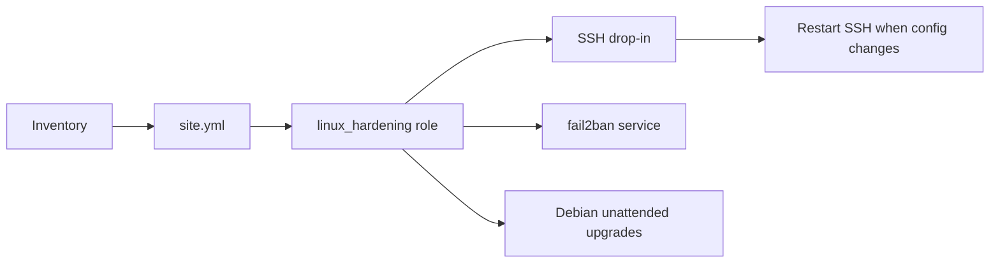

# Design document: Linux hardening with Ansible

## Problem

Linux hosts need a small, repeatable security baseline. Manual SSH edits drift, brute-force protection is easy to forget, and patching differs between Ubuntu and RHEL.

## Goal

Apply a reviewable Ansible role that works across both Linux families and changes only what is needed.

## Design



- `site.yml` selects the `linux` inventory group and enables privilege escalation.
- The role installs fail2ban on Debian and Red Hat families.
- Debian hosts also receive unattended upgrades.
- The template disables root login and password authentication, limits authentication attempts, and disables X11 and TCP forwarding.
- A handler restarts SSH only after the configuration changes.

## Safety and idempotency

Ansible modules compare the desired state with the current state. Re-running the role should report no changes after the host reaches the desired baseline. The SSH template uses `sshd -t` validation before the file is accepted.

## Verification

```bash
bash tests/test-structure.sh
ansible-playbook --syntax-check -i inventory.ini.example site.yml
ansible-playbook --check --diff -i inventory.ini.example site.yml
```

The CI job performs the structure test and syntax check. Check mode previews a real host without applying changes.

## Risks and limits

Disabling password authentication requires a working SSH key before rollout. Production use should add a staged rollout, an approved bastion path, fail2ban jail tuning, and host-specific package policy.

